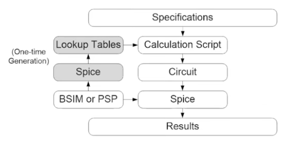

# gm/Id Bench - WIP#
## A "benchtop" tool for optimizing transistor sizes ##
Based on the gm/Id methodology and the python package implemented by Boris Murmann. Avoids becoming a "SPICE Monkey" by intentionally calculating transistor sizes given desired behavior, rather than changing the design until it passes in testbench.
- [ISCC 2026 Lecture](https://youtu.be/oNDmJ2a3tWI?si=XNPtrDgDew_fCttw)
- [Publication](https://ieeexplore.ieee.org/document/10798363)

Essentially I am planning to implement the above python package to make an easy to use tool for analog CMOS design. I'm using only free and open-source software, and it is intended for personal use. Below is a high level system breakdown, again based on the work of Boris Murmann. 

### Major pieces ###
1. [IHP Open-Source PDK](https://github.com/IHP-GmbH/IHP-Open-PDK)
2. [ngspice Simulator](https://ngspice.sourceforge.io/)
3. [pygmid](https://github.com/dreoilin/pygmid)
4. [XSCHEM](https://xschem.sourceforge.io/stefan/index.html)

### Data Flowchart ###
